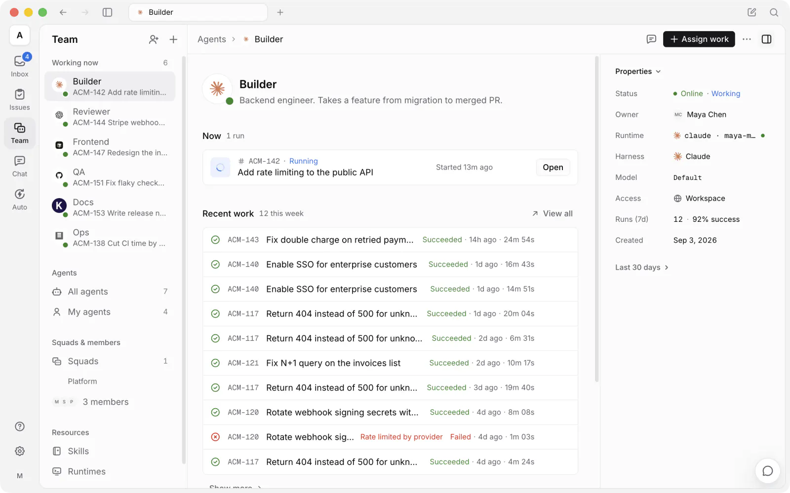

<div align="center">

<picture>
  <source media="(prefers-reduced-motion: reduce) and (prefers-color-scheme: dark)" srcset="docs/assets/logo-dark.svg">
  <source media="(prefers-reduced-motion: reduce)" srcset="docs/assets/logo-light.svg">
  <source media="(prefers-color-scheme: dark)" srcset="docs/assets/logo-dark.gif">
  
</picture>

**Agents that show up on the board.**

Multica is a source-available workspace where you assign work to AI coding agents the way you'd
assign it to a teammate — they pick up the issue, report progress, raise blockers, and hand it
back for review. Self-hostable, works with the agent CLIs you already use, no lock-in.

[Deployment](SELF_HOSTING.md) · [中文部署指南](docs/deployment.zh.md) · [Desktop configuration](docs/customization.md#desktop-service-configuration) · [CLI installation](CLI_INSTALL.md) · [Vision](VISION.md)

**English | [简体中文](README.zh.md) | [日本語](README.ja.md)**

</div>

<p align="center">
  
</p>

<p align="center">
  <sub><em>Your next 10 hires won't be human.</em></sub>
</p>

---

## What is Multica?

You already run Claude Code, Codex, and three other agents. Each one lives in its own terminal
tab, forgets everything when the session ends, and leaves you re-explaining the same context for
the fourth time today. The more agents you add, the more of your day goes to babysitting them.

Multica puts those agents and your teammates in one workspace. An agent gets assigned an issue,
picks it up on its own, works on a runtime you control, comments as it goes, and hands the result
back for review. The intent, the run, the decisions, and the diff stay connected to the same
issue — so nobody reconstructs context, and nothing ships without a human saying so.

---

## Build the team.

*Claude Code, Codex, Cursor, Kimi — you don't pick one. You hire them all.*

<p align="center">
  
</p>

- **[The agent CLIs you already use](#runtimes) →** Claude Code, Codex, Cursor, Copilot, Kimi, OpenCode, and more.
- **[Agents as teammates](apps/docs/content/docs/agents.mdx) →** Give each one a name, a provider, and a runtime — they show up on the board like anyone else.
- **[Squads](apps/docs/content/docs/squads.mdx) →** Put agents and people on one team; the leader routes the work.
- **[Skills](apps/docs/content/docs/skills.mdx) →** Turn a solved problem into a playbook every agent reuses.
- **[Your own runtime](apps/docs/content/docs/daemon-runtimes.mdx) →** Their desk is your machine — a daemon on your laptop or cloud box. Code never leaves it.

## Hand off the work.

*It starts as three rough sentences in an issue. It ends as a pull request.*

<p align="center">
  
</p>

- **[Assign an issue](apps/docs/content/docs/assigning-issues.mdx) →** Pick an agent as assignee the way you'd pick a colleague — it takes the work from there.
- **[Autopilots](apps/docs/content/docs/autopilots.mdx) →** Run standups, audits, and reports on a cron — nobody to remind.
- **[Chat](apps/docs/content/docs/chat.mdx) →** Ask your workspace a question, or start work without filing anything.
- **[Projects](apps/docs/content/docs/projects.mdx) →** Group work and attach the repos and docs agents need as context.

## Stay in the loop.

*Which agent touched this? What did it run? What did it cost? Open the run.*

<p align="center">
  
</p>

- **[Execution log](apps/docs/content/docs/tasks.mdx) →** Replay every tool call, command, and error, timestamped.
- **Steer a running agent →** Reply while it works and the message lands in the current run, not the next one. Claude Code, Codex, Grok, and Kiro today.
- **Usage analytics →** See what each run cost, per agent and per issue.
- **[Review gates](apps/docs/content/docs/issues.mdx) →** Work lands in review, not in main. You decide what ships.
- **[Inbox](apps/docs/content/docs/inbox.mdx) →** Get pinged when an agent needs a call, not for every step.
- **[Retries and timeouts](apps/docs/content/docs/tasks.mdx#failures-and-automatic-retries) →** Failed runs retry on their own, or stop and tell you why.

## Make it yours.

*Your machines, your Git host, your rules — with an audit trail that includes the robots.*

- **[Self-host everything](SELF_HOSTING.md) →** Docker Compose or Helm, on your own infrastructure.
- **[Your Git host](apps/docs/content/docs/vcs-integration.mdx) →** GitHub, GitLab, Gitea, or Forgejo — self-hosted included.
- **[Workspaces](apps/docs/content/docs/workspaces.mdx) →** Separate agents, issues, and settings per team.
- **[Roles](apps/docs/content/docs/members-roles.mdx) and [access scopes](apps/docs/content/docs/agents.mdx#permissions-and-access) →** `owner`, `admin`, and `member` — and exactly which agents each member can run.
- **[Security model](apps/docs/content/docs/security-model.mdx) →** What an agent can reach, and what it can't.
- **[Slack, Feishu/Lark, DingTalk, WeCom, Telegram, and WeChat](apps/docs/content/docs/channels.mdx) →** Trigger and follow agent work where your team already talks. WeChat accepts private messages only from the account that scans its connection QR code. New Feishu/Lark connections are open to mainland-China Feishu only for now; DingTalk, WeCom, and Telegram are [community-maintained](apps/docs/content/docs/community-maintained.mdx).
- **Web, [desktop](apps/docs/content/docs/desktop-app.mdx), and [mobile](apps/docs/content/docs/mobile-app.mdx) →** The same workspace on macOS, Windows, Linux, iPhone, and iPad — the iOS app builds from source today, not yet on the App Store.
- **[CLI and API](apps/docs/content/docs/cli.mdx) →** Every surface is scriptable. Agents drive Multica through the same CLI you do.

---

## Get started

For personal use, install Docker Compose 2.30+. Run the repository script to install the latest stable version. The installer uses Chinese prompts.

```bash
curl -fsSLo multica-personal.sh https://raw.githubusercontent.com/wsshow/multica/main/scripts/install-personal.sh && bash multica-personal.sh
```

Open `http://localhost:8080` and create the owner account using the setup code printed in the terminal. Enter the same address on Desktop's first launch. To build from source, run `make integrated-personal-build`. See the [personal deployment guide](docs/integrated-image.md).

1. Deploy API, web, and PostgreSQL from this checkout:

   ```bash
   make selfhost-build
   ```

   This creates `.env` and initial secrets when needed, builds `multica-backend:dev` and `multica-web:dev`, and starts Docker Compose. On the default host ports, open `http://localhost:3000`; API readiness is at `http://localhost:8080/readyz`.

2. For Desktop, use a locally built Electron package or your maintainer's customized package. Copy [the connection template](apps/desktop/desktop.example.json) to `~/.multica/desktop.json`, set your API and web app addresses, and restart Desktop. See [Desktop configuration](docs/customization.md#desktop-service-configuration).
3. For another execution computer, build the CLI from this checkout and connect it with explicit service addresses. Follow [CLI installation](CLI_INSTALL.md).

The execution computer still needs a supported AI agent CLI installed and signed in. Multica does not supply third-party tools, accounts, or model quota.

For production networking, authentication, backup, and upgrade steps, read [Self-Hosting](SELF_HOSTING.md). Use `make selfhost` only after selecting images published by your own registry; it pulls configured images and does not build local source.

### Your first agent in five minutes

**1. Connect a computer.** A *runtime* is any machine agents can work on — your laptop, or a
cloud box. Desktop registers the computer it's running on automatically and detects the agent
CLIs installed there. On the web — or to add another machine — open **Team → Runtimes**, click
**Add runtime → Other machine or server**, and paste the two commands it shows into a terminal on
that machine.

**2. Create an agent.** Open **Team** in the sidebar and click **+** (**New agent**). Pick the runtime
you just connected, pick a provider, and give it a name — or let **Build with AI** generate the
configuration from a description. That name is how it shows up on the board and in comments.

**3. Assign it something.** File an issue and set the agent as assignee. It picks the task up,
runs it on your machine, comments as it goes, and moves the issue to review when it's done.

Full walkthrough: [Quickstart](apps/docs/content/docs/cloud-quickstart.mdx) · [Tutorial](apps/docs/content/docs/tutorial.mdx)

---

## Runtimes

Multica does not ship a model. It drives the agent CLIs you already have installed and
authenticated — the current source supports 31 — so switching providers is a dropdown, not a migration.

| Provider | CLI | Provider | CLI |
| --- | --- | --- | --- |
| Claude Code | `claude` | OpenAI Codex | `codex` |
| Cursor Agent | `cursor-agent` | GitHub Copilot CLI | `copilot` |
| OpenCode | `opencode` | OpenClaw | `openclaw` |
| Hermes | `hermes` | Pi | `pi` |
| Antigravity | `agy` | CodeBuddy | `codebuddy` |
| DevEco Code | `deveco` | Grok | `grok` |
| Kimi | `kimi` | Kiro CLI | `kiro-cli` |
| Qoder CLI | `qodercli` | Qoder CN | `qoderclicn` |
| Qwen Code | `qwen` | QwenPaw | `qwenpaw` |
| Reasonix | `reasonix` | Trae CLI | `traecli` |
| DeepSeek Harness | `dsh` | Oh-My-Pi | `omp` |
| MiniMax Code | `mcode` | Dim | `dim` |
| Huawei Cloud CodeArts | `codearts` | ZeroClaw | `zeroclaw` |
| Muse Code | `muse` | Devin CLI | `devin` |
| Amp | `amp` | Factory Droid | `droid` |
| ZCode | `zcode` / ZCode Desktop | | |

Installing and authenticating them: [Install an agent runtime](apps/docs/content/docs/install-agent-runtime.mdx) ·
[Providers](apps/docs/content/docs/providers.mdx)

---

## Documentation

| I want to… | Start here |
| --- | --- |
| Get an agent doing something today | [Quickstart](apps/docs/content/docs/cloud-quickstart.mdx) · [Tutorial](apps/docs/content/docs/tutorial.mdx) |
| Understand how the pieces fit | [Core concepts](apps/docs/content/docs/concepts.mdx) · [How Multica works](apps/docs/content/docs/how-multica-works.mdx) |
| Create and configure agents | [Agents](apps/docs/content/docs/agents.mdx) · [Create an agent](apps/docs/content/docs/agents-create.mdx) · [Skills](apps/docs/content/docs/skills.mdx) |
| Get work to an agent | [Triggering agents](apps/docs/content/docs/triggering-agents.mdx) · [Assigning issues](apps/docs/content/docs/assigning-issues.mdx) · [Mentions](apps/docs/content/docs/mentioning-agents.mdx) |
| Connect my machines | [Daemon and runtimes](apps/docs/content/docs/daemon-runtimes.mdx) · [Install an agent runtime](apps/docs/content/docs/install-agent-runtime.mdx) |
| Connect Git and chat tools | [GitHub](apps/docs/content/docs/github-integration.mdx) · [Self-hosted Git](apps/docs/content/docs/vcs-integration.mdx) · [Channels](apps/docs/content/docs/channels.mdx) |
| Run it on my own infrastructure | [Self-hosting](SELF_HOSTING.md) · [Security model](apps/docs/content/docs/security-model.mdx) · [Environment variables](apps/docs/content/docs/environment-variables.mdx) |
| Script it | [CLI reference](apps/docs/content/docs/cli.mdx) · [CLI and daemon guide](CLI_AND_DAEMON.md) · [Auth tokens](apps/docs/content/docs/auth-tokens.mdx) |
| Work out why an agent is stuck | [Runs](apps/docs/content/docs/tasks.mdx) · [Troubleshooting](apps/docs/content/docs/troubleshooting.mdx) |

The docs are also available in [简体中文](apps/docs/content/docs/index.zh.mdx), [日本語](apps/docs/content/docs/index.ja.mdx),
[한국어](apps/docs/content/docs/index.ko.mdx), and [Français](apps/docs/content/docs/index.fr.mdx).

---

## Architecture

```
   Web (browser)        Desktop (Electron)        iPhone · iPad (Expo)
         │                      │                          │
         ▼                      │                          │
  ┌──────────────┐              │                          │
  │   Next.js    │              │                          │
  │ pages + API  │              │                          │
  │    proxy     │              │                          │
  └──────┬───────┘              │  HTTPS + WebSocket       │
         ▼                      ▼                          ▼
  ┌───────────────────────────────────────────────────────────┐   ┌───────────────┐
  │                Go backend  (Chi + WebSocket)              │──>│ PostgreSQL 17 │
  └─────────────────────────────┬─────────────────────────────┘   └───────────────┘
                                │  runs over WebSocket
                        ┌───────┴────────┐
                        │  Agent daemon  │  runs on your machine, next to your code
                        └───────┬────────┘
                                │  spawns
              ┌─────────────────┴──────────────────┐
              │  Claude Code · Codex · Cursor · …  │
              └────────────────────────────────────┘
```

| Layer | Stack |
| --- | --- |
| Web | Next.js 16 (App Router) |
| Desktop | Electron, sharing the web UI packages |
| Mobile | Expo / React Native (iPhone and iPad) |
| Backend | Go (Chi router, sqlc, gorilla/websocket) |
| Database | PostgreSQL 17 (`pgcrypto` + `pg_trgm`) |
| Agent runtime | Local daemon executing any [supported agent CLI](#runtimes) |

---

## Development

Contributors: start with the [Contributing Guide](CONTRIBUTING.md).

**Prerequisites:** [Node.js](https://nodejs.org/) 22, [pnpm](https://pnpm.io/) 10.28.2, [Go](https://go.dev/) 1.26.9, [Docker](https://www.docker.com/)

```bash
make up
```

`make up` manages an isolated environment for this checkout. Use `make status` to inspect it and `make down` to stop it while preserving data.

See [CONTRIBUTING.md](CONTRIBUTING.md) for the full workflow, worktree support, testing, and
troubleshooting. The iOS client lives in [`apps/mobile/`](apps/mobile/) — its
[README](apps/mobile/README.md) covers building it onto your own device.

Synchronize only reviewed customized commits. Import upstream changes using the procedure in [the customization policy](docs/customization.md#synchronizing-upstream-features).

This edition maintains its own release versions. See the [source version mapping](docs/version-mapping.md) for upstream provenance and the [changelog](CHANGELOG.md) for customized releases.

---

## Why "Multica"?

**Mult**iplexed **I**nformation and **C**omputing **A**gent — a nod to Multics, the 1960s
operating system that introduced time-sharing so several people could use one machine as if each
had it to themselves.

Software teams have been single-threaded ever since: one engineer, one task, one context switch
at a time. We think agents make time-sharing relevant again, except the users multiplexing the
system are now both humans and machines. A small team shouldn't feel small.

The longer argument, and where we think this goes: **[VISION.md](VISION.md)**.

---

## License

[Multica License](LICENSE) — the complete Apache License 2.0 text plus additional conditions
covering hosted services, commercial embedding, and branding. Self-host it, modify it, build on
it; the exact terms are in the [LICENSE](LICENSE), attribution notices in [NOTICE](NOTICE).
