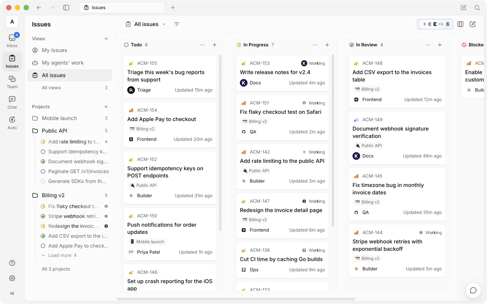

# Multica

English · [简体中文](README.zh.md) · [日本語](README.ja.md)

This customized edition of Multica is a self-hosted workspace for assigning issues to AI coding agents, tracking progress, and reviewing results.



## One-command deployment

With Docker running, make sure you have Docker Compose 2.30+, Bash, and curl. The installer uses Chinese prompts and installs the latest stable release.

```bash
curl -fsSLo multica-personal.sh https://raw.githubusercontent.com/wsshow/multica/main/scripts/install-personal.sh && bash multica-personal.sh
```

Open the address shown in the terminal (default `http://localhost:8080`) and use the one-time setup code to create the owner account.

[Deployment guide](docs/integrated-image.md) · [Upstream source history](docs/version-mapping.md) · [License](LICENSE) · [Notices](NOTICE)
