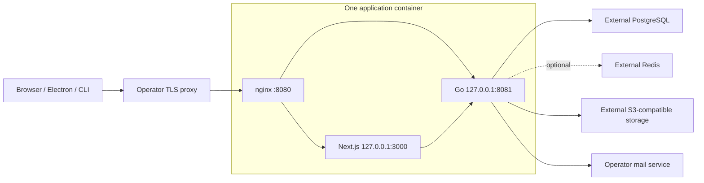

# Integrated application image

[中文版](integrated-image.zh.md)

The implementation combines the Go backend, Next.js standalone web server, and nginx in one application container. PostgreSQL, optional Redis, S3-compatible object storage, and production login delivery are configured externally. The existing split deployment remains available in [SELF_HOSTING.md](../SELF_HOSTING.md).

The integrated image is published by the new release workflow after validation. Existing `v0.1.2` artifacts do not include this image. A source commit alone does not publish it; use a version actually available in your configured Docker Hub repository.

## Architecture



The public URL is an explicit HTTP(S) origin without a path prefix. Container port `8080` is the only published application entry point. TLS terminates at the operator's outer proxy; HTTP is supported for a LAN deployment. Go and Node bind to loopback. Desktop explicitly sets both `apiUrl` and `appUrl` to the same reachable public origin. Agent tools and execution stay on Electron/CLI computers; the image does not start an executor.

Start with one application replica. Clustering still requires review of the existing Redis relay, channel leases, and background-job configuration. Plugin surfaces retain their separate cookie-free origin, which can route through the same gateway.

## Configuration and deployment

Prerequisites: Docker, Compose 2.30+, Bash, and OpenSSL. Node and Go are not needed on the deployment computer. Obtain this customized checkout and select an available image version from the operator's Docker Hub repository.

```bash
make integrated-init
# Edit .env.integrated, then replace the image placeholder below.
make integrated INTEGRATED_IMAGE=your-namespace/multica:X.Y.Z
```

The command pulls the selected image, starts the single application service, and waits for combined readiness. It never builds locally when an image is missing. The default host binding is `127.0.0.1:8080`, suitable for an outer TLS proxy. Use `INTEGRATED_HOST_PORT` to change the host port, or explicitly select `INTEGRATED_BIND_ADDRESS` for direct LAN access. These settings do not change the internal ports.

The [minimal example](../.env.integrated.example) contains:

| Input | Requirement |
| --- | --- |
| `MULTICA_PUBLIC_URL` | Reachable public origin; no official or localhost default |
| `DATABASE_URL` | External PostgreSQL connection URL and database, with the permissions required by the existing migrations |
| `JWT_SECRET` | Generated once by initialization; preserve across upgrades |
| `S3_BUCKET`, `S3_REGION` | Required external object storage; no local-upload fallback |
| `AWS_ENDPOINT_URL` | Required for a custom S3-compatible endpoint; omit for AWS S3 |
| `AWS_ACCESS_KEY_ID`, `AWS_SECRET_ACCESS_KEY` | Supply both or use the existing AWS credential chain |
| `REDIS_URL` | Optional for one instance; Redis-backed auth rate limits are disabled when omitted |
| SMTP settings and sender | Configure production email-code login; Google OAuth or configured Resend delivery are alternatives |
| `MULTICA_VCS_SECRET_KEY` | Initialized when the VCS feature is enabled; preserve it with the database backup |

Configuration is raw `KEY=value` data: use no surrounding quotes or shell expansion. Literal `$` and spaces in passwords are preserved. URL credentials must use URL encoding where needed. `.env.integrated` is never included as Make syntax or executed by a shell. Initialization preserves existing values, including existing keys. Use `INTEGRATED_ENV_FILE` to select another operator-owned file.

External service addresses must be reachable from the container. `localhost` inside a database or storage URL refers to the application container itself, not the Docker host. Use your service's network hostname or reachable IP; host-network mappings can be supplied through an operator Compose override.

The launcher derives the app, daemon, CORS, and callback URLs from the one public origin. Conflicting URL overrides fail rather than silently selecting one. Browser API and WebSocket URLs are same-origin build settings; keep `NEXT_PUBLIC_API_URL` and `NEXT_PUBLIC_WS_URL` empty. Internal `REMOTE_API_URL` and per-process ports are controlled by the launcher.

Use the [advanced example](../.env.integrated.advanced.example) for optional integrations and infrastructure settings. Behind an outer proxy, configure `MULTICA_GATEWAY_TRUSTED_PROXIES` with that proxy's actual IP/CIDR to retain client IPs. The gateway normalizes forwarding headers and the backend trusts only the loopback gateway. Cookie domain is normally left empty. Supply a sender you operate for SMTP/Resend. Fixed development login codes are rejected.

## Make commands

| Command | Behavior |
| --- | --- |
| `make integrated-init` | Prepare configuration and initial secrets without starting services |
| `make integrated INTEGRATED_IMAGE=…` | Pull, start, and wait for the published application image |
| `make integrated-status INTEGRATED_IMAGE=…` | Show container and health status |
| `make integrated-logs INTEGRATED_IMAGE=…` | Follow application logs |
| `make integrated-stop INTEGRATED_IMAGE=…` | Stop the application, preserving configuration and external data |
| `make integrated-build` | Explicit maintainer build from this checkout; does not start services |

The existing `selfhost` commands retain their split deployment. Run integrated and development targets in separate Make invocations. `INTEGRATED_BUILD_IMAGE` selects the maintainer build's local tag; it is separate from the explicitly selected deployment image. Do not run the build target when using a published image.

## Runtime behavior

Tini is PID 1. A Node launcher uses the runtime already present in the web image to validate configuration, generate nginx configuration, and supervise process groups. It runs the existing migrator first, preserving the database retry budget, migration advisory lock, and cancellation behavior. It then starts Go, checks backend readiness, starts Next.js, and starts the gateway after web readiness. Long-running migration DDL is not assigned a blanket connection-retry timeout.

Unexpected exit of any critical component terminates its siblings and fails the container. Docker's restart policy restarts the application as a unit. Normal stop drains the gateway briefly and sends termination to Go/Node, with a bounded deadline and process-group cleanup. `MULTICA_CONTAINER_SHUTDOWN_TIMEOUT` defaults to 60 seconds; the Compose grace period defaults to 75 seconds. If increasing shutdown holds or timeouts, increase `INTEGRATED_STOP_GRACE_PERIOD` as well.

The gateway sends `/api/*`, `/v1/*`, backend auth, browser/daemon WebSockets, uploads, and plugin surfaces to Go. `/auth/callback` and `/auth/hg-sso/callback` and their descendants remain Next.js routes. Other pages and compiled assets go to Next.js. WebSocket upgrade headers, unbuffered streaming, and the backend's 100 MiB request-body allowance are preserved.

`/health` is backend process liveness. Public `/readyz` and `/healthz` check nginx, the dynamic Node readiness route, and Go database/migration readiness. Docker healthcheck uses this combined endpoint. An unhealthy status alone does not restart a plain Docker container. Redis/S3 operations are not repeatedly performed by health probes. `/metrics` and `/health/realtime` remain unavailable.

S3 initialization errors stop startup rather than selecting local storage. Configuration validation does not establish bucket permissions; validate uploads using the operator's actual bucket before opening service to users. Attachment delivery defaults to the existing proxy mode, allowing private object-storage endpoints without exposing them to clients. Existing direct/CDN modes remain explicit options.

## Data and upgrades

All application processes run as UID/GID 1001. Temporary proxy/upload files use `/tmp`; Next.js caches use the writable container layer. These are disposable. Read-only root filesystem support is not claimed by the deployment example. Mount custom CAs or local plugin sources separately if configured.

Durable resources are PostgreSQL, object storage, and the operator's configuration and encryption keys. Back them up together, record the current image digest, select a new image version, and run `make integrated` again. Recreating the application must not rotate keys or lose attachments. An image rollback does not undo database migrations; confirm schema compatibility or restore matching backups. The image retains existing migration/maintenance tools for deliberate operator use.

## GitHub build and Docker Hub release

[The integrated workflow](../.github/workflows/integrated-image.yml) validates ordinary main/PR changes and is called by [Release](../.github/workflows/release.yml) for version tags. Configure these repository settings:

| Setting | Location | Value |
| --- | --- | --- |
| `DOCKERHUB_USERNAME` | Actions Variables | Docker Hub login account |
| `DOCKERHUB_IMAGE` | Actions Variables | Explicit `namespace/repository` |
| `DOCKERHUB_TOKEN` | Actions Secrets | Token allowed to push to that repository |

Buildx Bake reuses the existing backend and web Dockerfiles at one commit and platform. The assembly uses their compiled outputs; Go/pnpm compilation is not duplicated in the assembly Dockerfile. AMD64 and ARM64 use native runners. BuildKit caches build stages; the runtime includes no compiler or user credentials. This keeps customization in packaging with only listener/storage startup changes and the web readiness route in application code.

Each architecture builds and loads one final image, then runs the disposable [smoke fixtures](../docker/integrated/compose.smoke.yml). Checks cover compiled assets, SMTP login, CSRF writes, object uploads/downloads and Range, browser and daemon WebSocket authentication, container recreation, critical child failure, optional Redis, database outages, and graceful stop. Packaging unit tests, storage/listener tests, web readiness tests, typechecking, and telemetry checks also gate the workflow. These CI fixtures are not the user deployment file.

Only a version-tag call can publish. The tested image is pushed under a build-specific candidate tag without recompiling. Both native jobs must succeed before their digests become a shared `X.Y.Z` and `sha-<full-commit>` manifest. A successful stable version also updates `latest`; prereleases do not. Candidate tags are staging artifacts, not deployment recommendations. Existing GHCR split-image publication remains separate. Creating this implementation commit does not trigger a Docker Hub release.
