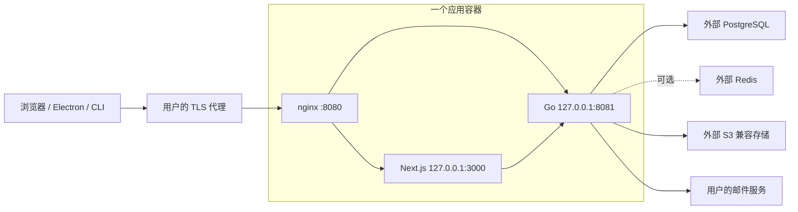

# 一体化应用镜像

[English](integrated-image.md)

一个应用容器包含 Go 服务端、Next.js standalone 页面服务和 nginx。个人部署面向单个所有者，默认使用随附的 PostgreSQL 服务和本地文件。外部服务部署支持外部 PostgreSQL、S3 兼容存储和邮箱验证码或 Google 登录。原有拆分部署见[部署指南](deployment.zh.md)。

## 个人部署

准备 Docker Compose 2.30+ 和 Bash，在定制仓库根目录运行以下任一命令。

```bash
# 从自己的 Docker Hub 仓库启动已发布版本。
make integrated-personal INTEGRATED_IMAGE=your-namespace/multica:X.Y.Z

# 或使用 Docker Buildx 从当前源码构建并启动。
make integrated-personal-build
```

打开终端打印的访问地址，默认是 `http://localhost:8080`。用同一终端显示的一次性设置码创建所有者账号。Multica 会创建「个人工作区」，之后使用用户名和密码登录。签名密钥、上传文件和数据库保存在 Docker 卷中，应用通过专用 Unix socket 连接随附的数据库。

从源码构建后，可以用 `make integrated-personal` 再次启动同一本地镜像。

| 命令 | 用途 |
| --- | --- |
| `make integrated-personal-setup-code` | 创建所有者前重新查看设置码 |
| `make integrated-personal-reset-password` | 生成并显示替换密码，以及所有者用户名 |
| `make integrated-personal-status` | 查看容器和健康状态 |
| `make integrated-personal-logs` | 跟踪应用日志 |
| `make integrated-personal-stop` | 停止应用和数据库，保留数据卷 |
| `make integrated-personal-backup BACKUP_FILE=multica.tar` | 暂停应用，将数据库、本地文件和密钥保存到归档 |
| `make integrated-personal-restore BACKUP_FILE=multica.tar INTEGRATED_IMAGE=…` | 在启动新的个人实例前恢复归档 |

默认启动无需环境文件。如需自有 PostgreSQL 或 S3 兼容存储，将[个人部署示例](../.env.integrated.personal.example)复制为 `.env.integrated.personal`，填写相应配置。在首次使用前选择存储，切换已有实例时需迁移已有数据。

上述命令备份随附数据库、本地文件和自动生成的密钥。恢复时，使用与备份相同的应用镜像版本和 PostgreSQL 主版本恢复到新数据卷，再启动应用。手动配置的环境文件和密钥随归档保存，外部 PostgreSQL 或 S3 另行备份。

通过 `INTEGRATED_HOST_PORT` 修改宿主机端口。远程使用时，在个人配置文件的 `MULTICA_PUBLIC_URL` 填写实际访问地址，并让 TLS 反向代理转发到发布端口。`INTEGRATED_BIND_ADDRESS` 控制该端口绑定的宿主机地址。

## 外部服务部署架构



显式配置一个不带路径前缀的 HTTP(S) 公共 origin。容器 `8080` 是唯一发布的应用入口；TLS 在外层代理终止，局域网也支持 HTTP。Go、Node 监听 loopback。桌面端仍显式把 `apiUrl`、`appUrl` 填为同一个实际可达地址。智能体工具和执行留在 Electron/CLI 执行电脑，镜像不启动执行器。

先按单应用实例部署；增加实例仍需审查现有 Redis relay、通道租约和后台任务配置。插件页面保留独立、无 Cookie 的 origin，可经同一网关转发。

## 外部服务配置与部署

部署电脑需要 Docker、Compose 2.30+、Bash 和 OpenSSL，无需安装 Node、Go。取得本定制源码，选择用户配置的 Docker Hub 仓库里可用的镜像版本。

```bash
make integrated-init
# 编辑 .env.integrated，再替换下面的镜像占位值。
make integrated INTEGRATED_IMAGE=your-namespace/multica:X.Y.Z
```

命令拉取镜像，启动唯一应用服务并等待整体就绪，镜像缺失时不会转为本地构建。默认绑定宿主机 `127.0.0.1:8080`，适合前置 TLS 代理。用 `INTEGRATED_HOST_PORT` 修改宿主机端口；需要直接供局域网访问时显式设置 `INTEGRATED_BIND_ADDRESS`。这些配置不改变内部端口。

[精简示例](../.env.integrated.example)包含：

| 输入 | 要求 |
| --- | --- |
| `MULTICA_PUBLIC_URL` | 实际可达的公共 origin，无官网或 localhost 默认值 |
| `DATABASE_URL` | 外部 PostgreSQL 连接 URL、数据库及执行现有迁移所需权限 |
| `JWT_SECRET` | 初始化时生成一次，升级时保留 |
| `S3_BUCKET`、`S3_REGION` | 必填外部对象存储，不回退到本地上传目录 |
| `AWS_ENDPOINT_URL` | 自定义 S3 兼容服务必填；AWS S3 可以省略 |
| `AWS_ACCESS_KEY_ID`、`AWS_SECRET_ACCESS_KEY` | 同时填写，或使用现有 AWS 凭据链 |
| `REDIS_URL` | 单实例可选，省略时 Redis 认证限流不启用 |
| SMTP 参数和发件地址 | 配置生产邮箱验证码登录，也可选择 Google OAuth 或已配置的 Resend 投递 |
| `MULTICA_VCS_SECRET_KEY` | 启用 VCS 功能时初始化，与数据库备份一起保留 |
| `MULTICA_WEIXIN_SECRET_KEY` | 可选微信扫码连接；使用 `openssl rand -base64 32` 生成并持久保留 |

配置是原始 `KEY=value` 数据，不加外层引号、不使用 shell 展开。密码中的 `$`、空格会保留；连接 URL 内的凭据按需使用 URL 编码。`.env.integrated` 不会作为 Make 语法 include，也不会被 shell 执行。初始化保留已有值及密钥，可用 `INTEGRATED_ENV_FILE` 选择另一个用户持有的文件。

外部服务地址必须从容器内可达。数据库或存储 URL 中的 `localhost` 指应用容器自身，不是 Docker 宿主机；使用服务的网络主机名或可达 IP，需要宿主机映射时通过用户的 Compose override 提供。

启动器从唯一公共 origin 派生应用、daemon、CORS 和回调地址，互相矛盾的 URL 配置会报错。浏览器 API/WebSocket 使用同源构建配置，保持 `NEXT_PUBLIC_API_URL`、`NEXT_PUBLIC_WS_URL` 为空。内部 `REMOTE_API_URL` 和各进程端口由启动器管理。

可选集成及基础设施参数见[高级示例](../.env.integrated.advanced.example)。前置代理时，把代理的真实 IP/CIDR 填入 `MULTICA_GATEWAY_TRUSTED_PROXIES`，保留客户端 IP；网关规范化转发头，后端只信任 loopback 网关。Cookie domain 通常留空。SMTP/Resend 使用自己运营的发件地址，固定开发验证码会被拒绝。

## Make 命令

| 命令 | 行为 |
| --- | --- |
| `make integrated-init` | 准备配置和初始密钥，不启动服务 |
| `make integrated INTEGRATED_IMAGE=…` | 拉取、启动已发布镜像，等待就绪 |
| `make integrated-status INTEGRATED_IMAGE=…` | 查看容器及健康状态 |
| `make integrated-logs INTEGRATED_IMAGE=…` | 跟踪应用日志 |
| `make integrated-stop INTEGRATED_IMAGE=…` | 停止应用，保留配置和外部数据 |
| `make integrated-build` | 维护者显式从当前源码构建，不启动服务 |

现有 `selfhost` 命令继续用于拆分部署。一体化与开发 target 分开调用 Make。`INTEGRATED_BUILD_IMAGE` 选择维护者构建的本地标签，与显式选择的部署镜像分开；使用已发布镜像时无需执行构建命令。

## 运行行为

Tini 作为 PID 1。Node 启动器复用页面服务已有运行时，负责校验配置、生成 nginx 配置和管理进程组。先执行现有迁移工具，保留数据库重试预算、迁移 advisory lock 和取消行为；再启动 Go 并检查后端就绪，启动 Next.js，页面服务就绪后启动网关。不会把数据库连接重试期限当作长耗时迁移 DDL 的统一超时。

任一关键组件意外退出，就停止其余组件并让容器失败，由 Docker 重启策略整体重启。正常停止时短暂排空网关，再终止 Go/Node；达到期限后清理进程组。`MULTICA_CONTAINER_SHUTDOWN_TIMEOUT` 默认 60 秒，Compose 停止宽限期默认 75 秒；增加 shutdown hold 或超时时，也要增加 `INTEGRATED_STOP_GRACE_PERIOD`。

网关把 `/api/*`、`/v1/*`、后端认证、浏览器/daemon WebSocket、上传和插件页面转给 Go。`/auth/callback`、`/auth/hg-sso/callback` 及其子路径保留给 Next.js；其他页面和编译资源由 Next.js 提供。保留 WebSocket upgrade、无缓冲流式响应和后端 100 MiB 请求体额度。

`/health` 是后端进程存活检查；公共 `/readyz`、`/healthz` 同时检查 nginx、动态 Node 就绪接口及 Go 数据库/迁移状态，镜像 healthcheck 使用这一整体检查。普通 Docker 不会仅因 unhealthy 自动重启。健康探针不反复操作 Redis/S3。`/metrics`、`/health/realtime` 继续不可用。

S3 初始化失败会终止启动，不再选择本地存储。配置校验不能证明桶权限正确，对用户开放前需使用实际桶验证上传。附件默认沿用 `proxy` 投递模式，私有对象存储地址无需暴露给客户端；直连/CDN 模式仍可显式配置。

## 数据与升级

应用进程使用 UID/GID 1001，代理和上传临时文件使用 `/tmp`，Next.js 缓存使用可写容器层，这些内容可以丢弃。部署示例暂不声明支持只读根文件系统。自定义 CA、本地插件源码按需独立挂载。

持久化资源是 PostgreSQL、对象存储、用户持有的环境配置及加密密钥。备份这些资源、记录镜像 digest，再选择新版本重新运行 `make integrated`。重建应用不能轮换密钥或丢失附件；回退镜像不等于撤销数据库迁移，需要确认 schema 兼容或恢复对应备份。镜像保留迁移和维护工具供显式运维使用。

## GitHub 构建与 Docker Hub 发布

[一体化 workflow](../.github/workflows/integrated-image.yml)验证普通 main/PR 变更，由 [Release](../.github/workflows/release.yml)在版本 tag 时调用。仓库配置如下：

| 设置 | 位置 | 值 |
| --- | --- | --- |
| `DOCKERHUB_USERNAME` | Actions Variables | Docker Hub 登录账号 |
| `DOCKERHUB_IMAGE` | Actions Variables | 显式 `namespace/repository` |
| `DOCKERHUB_TOKEN` | Actions Secrets | 有权向该仓库推送的令牌 |

Buildx Bake 在同一源码提交和架构下复用现有后端、Web Dockerfile。组装阶段消费它们的编译产物，不重复维护 Go/pnpm 编译步骤；AMD64、ARM64 使用原生 runner。BuildKit 缓存构建阶段，运行镜像不包含编译器和用户凭据。定制主要留在打包层，应用代码只增加监听/存储启动处理及 Web 就绪接口。

普通 main 与 PR 在 AMD64 构建镜像，发布时增加原生 ARM64 构建。各构建运行[外部服务测试环境](../docker/integrated/compose.smoke.yml)，覆盖静态资源、SMTP 登录、对象存储、WebSocket、就绪状态和关闭行为。AMD64 任务还使用个人部署的 Compose 配置验证[账号初始化和数据持久化](../docker/integrated/personal-smoke.sh)。打包和遥测检查在构建镜像之前运行。

新版本仅由版本 tag 触发发布。测试后的同一镜像导出后按 digest 上传，不重新编译，也不创建临时标签。两个原生架构任务都成功后，其 digest 才合并为 `X.Y.Z` manifest。稳定版本成功后更新 `latest`，预发布版本不更新。公开仓库只保留正式版本及 `latest`，源码提交记录在镜像标签元数据和工作流中。现有 GHCR 拆分镜像另行发布；单独提交源码不会自动发布 Docker Hub 版本。

清理旧发布流程遗留的内部标签时，运行 **Clean Docker Hub tags**，填写当前稳定版本。工作流使用已有 AMD64、ARM64 镜像验证按 digest 上传，再删除已经由稳定版 manifest 保留的内部别名。版本号和 `latest` 保持不变。此维护操作要求 `DOCKERHUB_TOKEN` 具备标签删除权限；常规发布只需读写权限。
