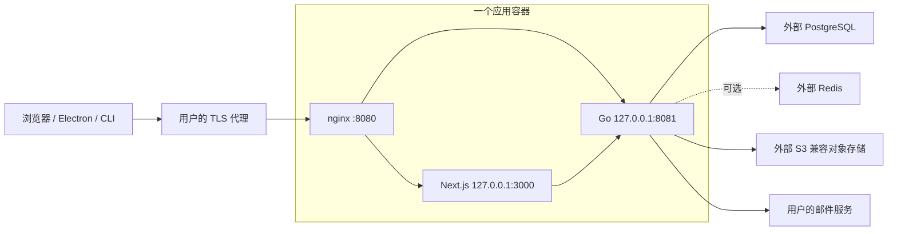

# 一体化应用镜像设计

[English](integrated-image.md)

状态：待实现的设计方案。下述一体化镜像、部署文件和检查尚未提供。当前发行仍使用独立的后端与 Web 镜像；一体化镜像通过发布验收之前，继续使用[现有部署指南](deployment.zh.md)。

## 部署约定

一个应用镜像包含现有 Go 服务端、Next.js standalone 页面服务和内部 nginx 网关。PostgreSQL、Redis、S3 兼容对象存储和生产邮件服务由用户在外部部署或配置。单实例应用可以不配置 Redis。

- 仅发布容器的 `8080` 端口。TLS 在用户的外层代理终止；局域网部署也可以直接使用 HTTP。
- 通过 `MULTICA_PUBLIC_URL` 显式配置一个公共 origin，不带路径前缀。第一版支持根路径部署。
- 桌面端仍显式填写 `apiUrl`、`appUrl`，两者可以使用同一个公共地址，无需修改桌面端配置或连接默认值。
- 智能体工具和执行仍位于 Electron/CLI 执行电脑。应用容器不启动 daemon，也不挂载宿主机 Docker socket。
- 第一版按单应用实例编写部署说明。增加实例前仍需审查已有 Redis relay、通道租约和后台任务配置；合并镜像不会自动建立新的集群运行约定。
- 保留现有拆分镜像及 Compose 部署，新增一体化镜像时不替换它们。

## 构建与源码复用

使用 Docker Buildx Bake 的命名上下文，在同一个源码提交、同一个目标架构下复用现有 `Dockerfile` 与 `Dockerfile.web` 的产物。新增组装 Dockerfile 消费这些上下文，不复制 Go 编译、pnpm 安装或 Next.js 构建流程。Bake 支持[将其他构建目标作为上下文](https://docs.docker.com/build/bake/contexts/#using-a-target-as-a-build-context)。

直接以现有 Web runner 作为组装基础，继承精确 Node 版本、安全版本下限、standalone/static/public 产物和 `LICENSE`、`NOTICE`。增加 nginx、Bash、Tini、CA 证书、时区数据，以及来自后端上下文的 Go 服务端、迁移与维护工具和迁移文件。构建时安装软件包可以使用 root，最终仍以非 root 用户运行。不复制构建工具链或源码目录里的凭据。缺少命名上下文时必须构建失败，不能转而从镜像仓库解析同名应用镜像。

构建时保持浏览器 API/WebSocket 地址为空，使客户端使用同源路径；仅将应用版本等发行信息写入产物。部署地址、密码和服务凭据都在运行时传入。启动应用时不下载其他 Multica 二进制或客户端包。

拟使用发行名称 `ghcr.io/<repository-owner>/multica:<release-tag>`，与后端、Web 镜像并存。实际 owner 读取 Actions 仓库信息。部署显式选择 tag 或 digest；该名称目前不代表已有可用产物。

## 精简配置

提供独立的 `.env.integrated.example`，与完整开发配置 `.env.example` 分开。尽量复用已有环境变量名称：

| 分组 | 用户填写 | 行为 |
| --- | --- | --- |
| 访问地址 | `MULTICA_PUBLIC_URL` | 必填 HTTP(S) origin，无官网或 localhost 默认值 |
| 数据库 | `DATABASE_URL` | 必填外部数据库，复用现有迁移和连接重试 |
| 认证 | `JWT_SECRET` | 必填、长期保留的随机密钥，部署准备时生成 |
| 对象存储 | `S3_BUCKET`、`S3_REGION`；自定义服务另填 `AWS_ENDPOINT_URL` | 此部署模式要求外部存储，不回退到本地上传目录 |
| 存储凭据 | `AWS_ACCESS_KEY_ID` 与 `AWS_SECRET_ACCESS_KEY`，或现有 AWS 凭据链 | 只填写一项静态凭据时报错，凭据不写入镜像 |
| Redis | `REDIS_URL` | 可选；省略时使用单节点实时通信，且 Redis 认证限流不启用 |
| 邮件 | SMTP 参数及 `SMTP_FROM_EMAIL`，或配置 Resend 凭据和发件地址 | 生产邮箱验证码登录必须说明如何配置可用的投递方式 |

TLS/CA、Redis 集群、代理信任、附件投递、注册控制和集成参数放在高级示例或参考文档中，保留既有行为。生产登录不应依赖从容器日志中寻找验证码，也不预填原项目的发件地址。

初始化命令只在用户持有的配置文件里生成一次密钥，不覆盖已有值。启用对应功能时再生成或配置 `MULTICA_VCS_SECRET_KEY`、插件密钥等；升级时保留，不能依赖容器文件系统保存。不同用途的加密密钥不从 `JWT_SECRET` 派生，也不在每次启动时重新生成。

启动器把唯一公共地址转换成现有 `FRONTEND_ORIGIN`、`MULTICA_APP_URL`、公共 daemon 地址和同源 CORS 配置。`REMOTE_API_URL` 固定指向容器内部 Go 监听地址。Go 与 Node 分别接收端口和监听配置，不能共享同一个 `PORT` 导致冲突。公共地址参数互相矛盾时报错，不用隐藏的优先级选择其一。浏览器的 `NEXT_PUBLIC_*` 配置不能依赖在运行时替换构建中已内联的值。

环境文件作为数据传入，不使用 `source` 或 `eval` 执行。可选 Compose 示例使用 `env_file` 的 `format: raw`，说明需要 Compose 2.30+，保留凭据中的 `$` 等字面字符；也支持 Docker `--env-file`。镜像/tag、宿主机端口放在部署命令或 Compose 输入中，与应用配置分开。[Compose 环境文件行为](https://docs.docker.com/reference/compose-file/services/#format)

## 网关路由

保留请求路径、查询参数、认证与 Cookie 请求头，以及响应安全头。路由约定如下：

| 请求 | 目标 |
| --- | --- |
| `/auth/callback` 及子路径、`/auth/hg-sso/callback` 及子路径 | Next.js，优先于通用认证路由 |
| `/api`、`/api/*`、`/v1`、`/v1/*` | Go |
| 其他 `/auth`、`/auth/*` 请求 | Go |
| `/ws`、`/api/daemon/ws` | Go，支持 WebSocket upgrade |
| `/uploads`、`/uploads/*`、`/plugin-surfaces/*` | Go，保留已有链接及域名边界 |
| `/health` | 现有 Go 进程存活检查 |
| `/readyz`、`/healthz` | 经 Next.js 的整体就绪检查，见下文 |
| 其他路径，包括 `/_next/*` | Next.js |

显式转发浏览器和 daemon WebSocket 所需的 upgrade 请求头，按心跳行为配置超时，流式响应关闭缓冲。网关请求体限制不能低于后端已有的 100 MiB 请求限制，避免 nginx 默认上传限制缩小可上传范围。验证 Range 下载、附件预览和重定向。[nginx WebSocket 代理](https://nginx.org/en/docs/http/websocket.html)、[代理缓冲](https://nginx.org/en/docs/http/ngx_http_proxy_module.html#proxy_buffering)

保留公共 Host 和协议。客户端 IP 转发头只接受明确配置的可信外层代理，再由网关规范化后传给 Go；Go 信任容器内的 loopback 网关。不能信任任意入站转发头，也不能丢失真实客户端 IP，否则会影响来源校验和按 IP 限流。外层代理信任范围作为高级配置，默认留空。

附件默认使用现有 `proxy` 投递模式，让对象存储可以位于私网。不开启公开桶，不改写已有对象 URL；需要时显式配置直连/CDN 模式。插件页面仍要求独立、无 Cookie 的 origin，可经同一网关转发，并保留已有域名边界，不能强行合并到应用 origin。

## Make 命令

镜像和 Compose 文件实现时，新增独立的 `integrated` 命令组。以下为拟定名称，目前还不是可执行的 target：

| 命令 | 职责 |
| --- | --- |
| `make integrated-init` | 缺少配置时创建 `.env.integrated` 和初始密钥，保留已有值；不启动、不构建 |
| `make integrated` | 要求用户配置和明确的镜像引用，拉取镜像，启动唯一应用服务，等待整体就绪 |
| `make integrated-status` | 查看应用容器及健康状态 |
| `make integrated-logs` | 查看应用日志 |
| `make integrated-stop` | 停止应用部署，不删除配置、不操作外部服务 |
| `make integrated-build` | 维护者显式从当前源码构建一体化镜像，不隐式启动 |

日常部署命令不进行本地编译。现有 `selfhost`、`selfhost-build`、`selfhost-stop` 保持原样。新命令真正可用后才加入 `make help`，不增加没有部署任何内容却返回成功的占位命令。

这些命令需要与 Makefile 现有的开发 `.env` 加载及导出的 localhost/端口默认值隔离。`.env.integrated` 作为原始数据直接传给 Compose，不作为 Make 语法 include，也不复制开发配置的值。缺少配置或镜像选择时，报错并说明对应准备步骤；拉取镜像失败不会自动改为源码构建。就绪检查失败返回非零状态，保留日志供排查。

## 启动、故障和停止

使用 Tini 作为 PID 1，以小型 Bash 启动器管理三个应用进程。Tini 负责信号转发和孤儿进程回收；启动器负责顺序、子进程退出检测和对各组件进程组有时限的停止。不增加第二套服务管理器，也不单独重启某个失败组件。[Docker 多进程说明](https://docs.docker.com/engine/containers/multi-service_container/)、[Tini 职责](https://github.com/krallin/tini#tini---a-tiny-but-valid-init-for-containers)

1. 校验必填配置，错误信息不输出密钥；以非 root 用户准备可写运行目录和缓存目录。
2. 执行一次现有迁移工具，保留 `docker/entrypoint.sh` 的共享启动重试预算、迁移 advisory lock 和取消行为。数据库、权限或迁移失败时终止启动，不先提供看似可用但后端未就绪的页面。
3. Go 监听 loopback，在启动期限内等待其现有 `/readyz`；随后启动监听 loopback 的 Next.js，等待其就绪接口，再以前台方式启动 nginx。所有等待都必须同时检测子进程是否已退出。
4. 正常运行后，Go、Next.js 或 nginx 任意一个意外退出，就停止其余进程，让容器以失败状态退出，即使该子进程返回的是零。由 Docker 重启策略重启整个应用。
5. 收到 `SIGTERM`/`SIGINT` 时先停止网关接收新请求，限时排空，再终止并等待 Go、Next.js，保留 Go 现有后台任务停止流程；超过期限才强制清理剩余后代进程。Compose 的停止宽限期必须长于该期限，用户配置的 shutdown hold 也要计入。

数据库重试预算不作为整个迁移 DDL 的超时限制。保留长耗时迁移，并允许为它们调整健康检查的启动宽限期；迁移完成后的进程就绪等待仍需有时限。

Go 需要增加一个明确的监听 host 参数：目前监听地址是 `":" + PORT`，仅发布一个容器端口不会让内部 API 自动只监听 loopback。保留拆分部署的默认值，一体化启动器选择 `127.0.0.1`；不向 Go 业务路由添加前端代理。

现有存储构造器可能返回 nil 并回退到本地文件。一体化启动器拒绝缺少 S3 配置；共享服务端初始化也要在显式配置的 S3 初始化失败时停止，拆分部署未配置 S3 时仍可选择本地存储。配置校验不等于已验证桶权限；不要求额外的列桶权限，也不在每次启动或健康检查时写测试对象。

## 健康检查和持久化

新增动态、无缓存的 Next.js `/readyz` 路由，带短超时检查内部 Go `/readyz`。nginx 将 `/readyz` 和别名 `/healthz` 转给它。通过容器公共端口返回成功，就验证了网关路由、Node 请求处理和 Go 的数据库/迁移就绪状态。这些路径名已被保留。响应只返回简短状态，不包含凭据或基础设施详情；后端已有响应保持不变。

镜像 healthcheck 调用这个整体就绪接口，数据库或前端不可用时标记 unhealthy。普通 Docker 不会仅因 unhealthy 自动重启，进程管理与编排行为要分开说明。Redis/S3 故障由受影响功能返回错误，不用反复写对象的方式把就绪检查扩大为集成测试。[Docker healthcheck 行为](https://docs.docker.com/reference/dockerfile/#healthcheck)

所有进程默认以非 root 用户运行。运行配置、代理临时文件、multipart 临时文件和 Next.js 缓存需要可写空间，使用临时目录并说明可选缓存挂载；业务数据及长期密钥不能依赖这些目录保存。只有通过相应 CI 验证后，才声明支持只读根文件系统及其必要可写挂载。自定义证书和用户提供的插件源码按需单独挂载。

持久化内容是外部数据库、对象存储和用户保存的环境配置/密钥。重建应用容器不能丢失附件、轮换密钥或重置账号。升级前备份这些资源，记录当前镜像 digest；新镜像执行正向迁移，回退镜像不等于撤销数据库迁移。保留维护工具供显式运维使用，不在已有迁移约定之外自动执行其他历史回填。

## 交付与验收

实现时新增组装 Dockerfile 与 Bake 目标、`docker/integrated/` 下的启动器/网关/健康检查文件、小型 Web 就绪路由及 Go 监听参数、仅一个应用服务的 Compose 示例、精简和高级环境示例，以及上述 Make 命令。存储初始化落实前述严格行为；现有拆分镜像入口保持原样。测试与对应实现放在一起。

在 GitHub Actions 构建并验证 `linux/amd64`、`linux/arm64`，前后端来自同一经过审查的 commit。保留 Go 漏洞检查、遥测检查、不可变发行 tag、源码/版本标签和当前发布流程。两个架构都通过才发布一体化 manifest/tag，失败时不覆盖上次已验证的 `latest`。不能混装不同版本前后端，也不能使用浮动 tag 拼装。本设计任务不做本地应用构建或打包。

发布必须有以下证据：

- 公共 URL、数据库配置、JWT 密钥或 S3 配置缺失/错误时，给出脱敏且可操作的报错。包含空格、`$` 和 URL 编码分隔符的凭据能正确传入。
- 数据库延迟就绪、认证失败、迁移失败及迁移中取消，均符合启动/退出约定；复用现有迁移锁，不新增一套锁。
- 经唯一公共 origin 完成浏览器登录/退出、OAuth 回调、带 CSRF 校验的写操作、公共链接生成，以及 Desktop/CLI 自建服务连接；覆盖局域网 HTTP、代理 HTTPS 和真实客户端 IP 转发。
- 浏览器与 daemon WebSocket 保持连接并能重连；流式输出逐步到达。对外部测试对象存储验证接近上限的上传、认证下载、Range 请求和预览。
- 缺少 S3 不会在本地保存上传文件；重建容器后账号、附件和配置的加密密钥保留。启用插件页面时仍使用无 Cookie 的独立 origin。
- 杀死任一关键子进程会结束整个容器；正常停止不残留子进程。Node、Go、数据库任一不可用时整体健康检查失败。不配置 Redis 仍能使用说明中的单实例基础能力，并清楚报告 Redis 限流未启用。
- 遥测保持空实现，不新增官方 Multica 服务、更新器、安装器、分析 SDK、指标监听器或额外执行器。测试使用假执行器，不调用用户安装的智能体工具。

第一步完成镜像组装、启动生命周期及整体健康检查；第二步通过完整的同源、附件和认证验证；之后才接入发行和修改推荐部署说明。设计提交本身不代表一体化镜像已经可部署。
